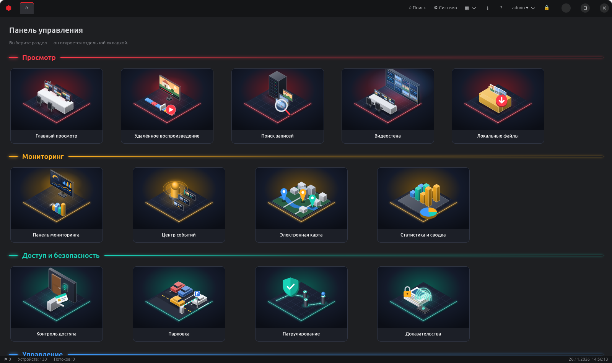
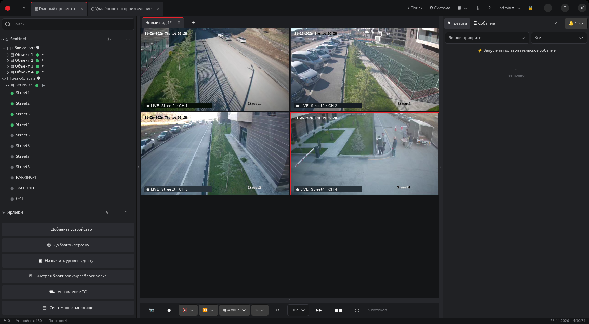
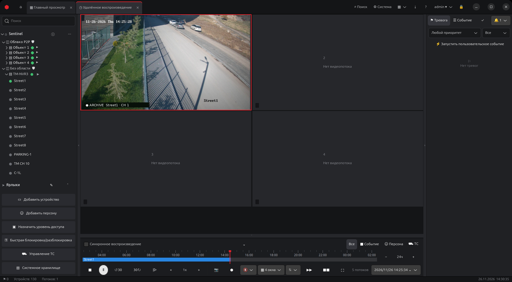
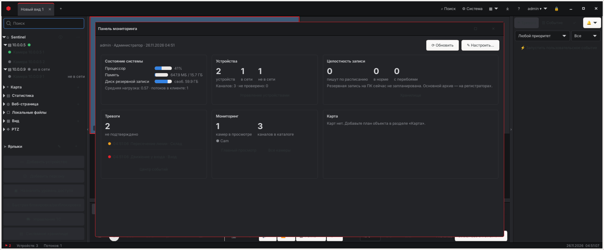
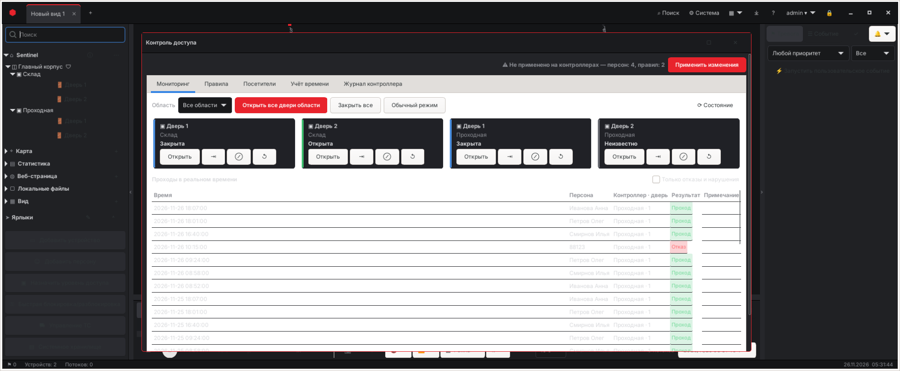
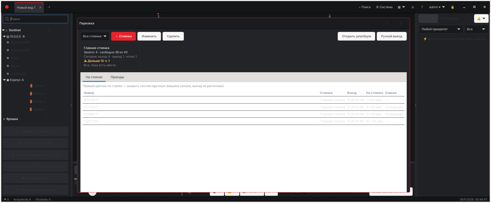
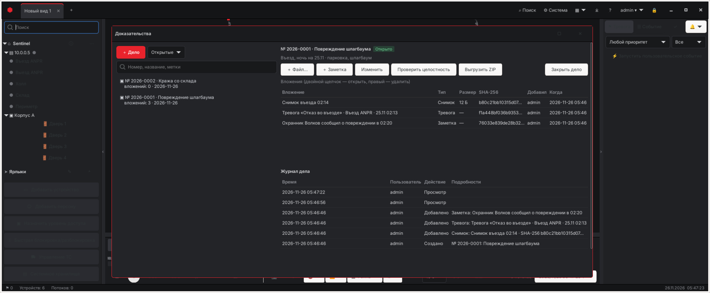

<div align="center">


# Sentinel PRO

**Универсальный центр управления безопасностью для Linux**

Видеонаблюдение, архив, тревоги, контроль доступа, парковка и патрулирование в одном окне оператора.

[](https://github.com/Valeritylive/sentinel-client/releases)


[](LICENSE)

[Возможности](#возможности) · [Скриншоты](#скриншоты) · [Установка](#установка) · [Руководство](docs/MANUAL.md)



</div>

## О программе

Sentinel PRO — рабочее место оператора системы безопасности: камеры, регистраторы, контроллеры доступа и шлагбаумы управляются из одного приложения. Программа не привязана к одному производителю. Сейчас поддерживаются устройства с ISAPI, любые RTSP-камеры и облачный P2P-доступ, другие протоколы будут добавляться.

Клиент работает самостоятельно, а с **Sentinel Server** получает общий каталог устройств, пользователей и роли, круглосуточную обработку событий и горячий резерв из двух серверов.

## Возможности

| | |
|---|---|
| 🎥 **Живой просмотр** | Сетки до 64 камер, виды во вкладках, несколько мониторов, PTZ с джойстиком и рамкой приближения, цифровой зум, звук и двусторонняя связь |
| ⏪ **Архив** | Поиск по камере, регистратору или области, цветная шкала по типу записи, синхронное воспроизведение, скорость 0.25×–8× |
| 📦 **Экспорт с доказательной силой** | MP4 без перекодирования, плеер в браузере, `SHA256SUMS` и журнал дел с цепочкой хранения |
| 🚨 **Тревоги и события** | Правила с расписанием и действиями (снимок, запись, тревожный выход, PTZ-пресет, email), постановка на охрану по областям |
| 🗺️ **Электронная карта** | Планы этажей и онлайн-карты, точки камер, дверей и датчиков мигают при событиях |
| 🚪 **Контроль доступа** | Двери в реальном времени, уровни доступа, анти-passback, шлюз, посетители, учёт рабочего времени |
| 🚗 **Парковка** | Распознавание номеров, белые и чёрные списки, шлагбаумы, занятость мест |
| 🛡️ **Патрулирование** | Маршруты обхода по контрольным точкам, отчёт о пропусках и опозданиях |
| 🖥️ **Видеостена** | Мониторы компьютера как стена, сценарии, экран тревог |
| ☁️ **Облако P2P** | Импорт устройств из облачного аккаунта, живое видео без проброса портов |
| ⚡ **Аппаратное декодирование** | VA-API (Intel, AMD), NVDEC (NVIDIA), V4L2 |
| 🏢 **Sentinel Server** | Роли и права, REST API, кластер «основной + резервный» с автоматическим переключением |

## Скриншоты

<table>
<tr>
<td width="50%"><br><sub><b>Живой просмотр</b> — дерево ресурсов, видеосетка, панель тревог</sub></td>
<td width="50%"><br><sub><b>Воспроизведение</b> — архив регистратора на шкале времени</sub></td>
</tr>
<tr>
<td><br><sub><b>Панель мониторинга</b> — состояние системы, устройств и записи</sub></td>
<td><br><sub><b>Контроль доступа</b> — двери и проходы в реальном времени</sub></td>
</tr>
<tr>
<td><br><sub><b>Парковка</b> — машины на стоянке и проезды</sub></td>
<td><br><sub><b>Доказательства</b> — дела, вложения и журнал хранения</sub></td>
</tr>
</table>

Все разделы со скриншотами описаны в [руководстве пользователя](docs/MANUAL.md).

## Установка

Готовые пакеты для x86_64 лежат в [Releases](https://github.com/Valeritylive/sentinel-client/releases).

```sh
# клиент
sudo apt install ./sentinel-pro_<версия>_amd64.deb

# сервер (необязательно)
sudo apt install ./sentinel-pro-server_<версия>_all.deb
```

Также доступны **Flatpak** и **AppImage**. Запуск из исходников:

```sh
sudo apt install python3-gi gir1.2-gtk-4.0 gir1.2-gstreamer-1.0 \
  gstreamer1.0-plugins-base gstreamer1.0-plugins-good \
  gstreamer1.0-plugins-bad gstreamer1.0-libav libsecret-tools ffmpeg python3-gi-cairo
python3 app.py
```

Подробности по каждому способу, серверу и кластеру — в разделе [«Установка»](docs/MANUAL.md#установка) руководства.

## Документация

- 📖 [Руководство пользователя](docs/MANUAL.md) — все разделы программы со скриншотами
- 🏢 [Sentinel Server и REST API](docs/MANUAL.md#sentinel-server)
- 🔁 [Кластер: горячий резерв](docs/MANUAL.md#кластер-горячий-резерв)
- 🛠️ [Сборка и разработка](docs/MANUAL.md#сборка-и-разработка)

## Лицензия

[MIT](LICENSE)
