# Sentinel PRO — руководство пользователя

Полное описание возможностей клиента Sentinel PRO и сервера Sentinel Server. Краткий обзор программы — в [README](../README.md).

Доступность отдельных команд (поиск архива, скорость воспроизведения, PTZ, операции контроля доступа) зависит от модели устройства и его прошивки.

## Содержание

1. [Установка](#установка)
2. [Первый запуск и устройства](#первый-запуск-и-устройства)
3. [Интерфейс](#интерфейс)
4. [Живой просмотр](#живой-просмотр)
5. [Архив и воспроизведение](#архив-и-воспроизведение)
6. [Панель мониторинга](#панель-мониторинга)
7. [Тревоги, события и охрана](#тревоги-события-и-охрана)
8. [Электронная карта](#электронная-карта)
9. [Контроль доступа](#контроль-доступа)
10. [Парковка](#парковка)
11. [Патрулирование](#патрулирование)
12. [Доказательства](#доказательства)
13. [Видеостена](#видеостена)
14. [Окно «Система»](#окно-система)
15. [Декодирование на видеокарте](#декодирование-на-видеокарте)
16. [Резервная запись и резервное копирование](#резервная-запись-и-резервное-копирование)
17. [Облако P2P](#облако-p2p)
18. [Sentinel Server](#sentinel-server)
19. [Кластер: горячий резерв](#кластер-горячий-резерв)
20. [Хранение данных и безопасность](#хранение-данных-и-безопасность)
21. [Сборка и разработка](#сборка-и-разработка)
22. [Ограничения](#ограничения)

---

## Установка

### Пакет .deb

Релизные пакеты собираются для x86_64 и прикладываются к [GitHub Releases](https://github.com/Valeritylive/sentinel-client/releases). Пакет сам ставит нужные компоненты GTK и GStreamer.

```sh
sudo apt install ./sentinel-pro_<версия>_amd64.deb
```

### Flatpak

```sh
flatpak remote-add --user --if-not-exists flathub https://dl.flathub.org/repo/flathub.flatpakrepo
flatpak install --user ./Sentinel-<версия>-x86_64.flatpak
flatpak run io.sentinel.SentinelPro
```

Во Flatpak данные хранятся отдельно: `~/.var/app/io.sentinel.SentinelPro/data/sentinel` (а не `~/.local/share/sentinel`). До 0.6.4.3 Flatpak-версия называлась `io.sentinel.VideoClient`. Чтобы перенести её данные, один раз до первого запуска новой версии выполните:

```sh
mkdir -p ~/.var/app/io.sentinel.SentinelPro/data && \
  cp -a ~/.var/app/io.sentinel.VideoClient/data/sentinel ~/.var/app/io.sentinel.SentinelPro/data/
```

### AppImage

AppImage включает Python, GTK, GStreamer, Secret Service CLI и FFmpeg из Ubuntu 22.04. Видеодрайверы и службу Secret Service предоставляет рабочее окружение.

### Из исходников

Требования:

- Linux с GTK 4 и PyGObject (`python3-gi`);
- GStreamer 1.x: playbin, RTSP, appsink, декодеры H.264/H.265 и конвертер видео;
- FFmpeg для ручной записи и экспорта (для живого просмотра не нужен);
- `libsecret-tools` и работающий пользовательский Secret Service (например, GNOME Keyring).

```sh
sudo apt install python3-gi gir1.2-gtk-4.0 gir1.2-gstreamer-1.0 \
  gstreamer1.0-plugins-base gstreamer1.0-plugins-good \
  gstreamer1.0-plugins-bad gstreamer1.0-libav libsecret-tools ffmpeg \
  python3-gi-cairo

python3 app.py      # запуск из рабочего каталога
./install.sh        # пункт в меню приложений
```

Для встроенного просмотра веб-страниц в ячейке нужен `gir1.2-webkit-6.0`, без него страница открывается в браузере.

Сервер ставится отдельным пакетом, см. [Sentinel Server](#sentinel-server).

---

## Первый запуск и устройства

Каталог камер хранится в SQLite в `$XDG_DATA_HOME/sentinel` (обычно `~/.local/share/sentinel`).

**Добавление регистратора.** Укажите адрес, логин и пароль. Sentinel PRO запрашивает список каналов через доступные маршруты ISAPI (IP-входы, видеовходы или потоковые каналы) и создаёт записи автоматически, после подключения сообщает число найденных каналов. Для произвольной RTSP-камеры диапазон каналов задаётся вручную.

Другие способы добавления в «Система › Управление устройствами»: «Автопоиск» в локальной сети, «Пакетный импорт» из CSV, «Вручную» и [облако P2P](#облако-p2p).

**Раздел «Устройства».** Каналы сгруппированы по регистратору, адресу и портам. Можно отметить отдельные каналы, выбрать все сразу или удалить всю группу регистратора с подтверждением. При удалении останавливаются потоки и очищаются связанные назначения и учётные данные последнего канала регистратора.

---

## Интерфейс

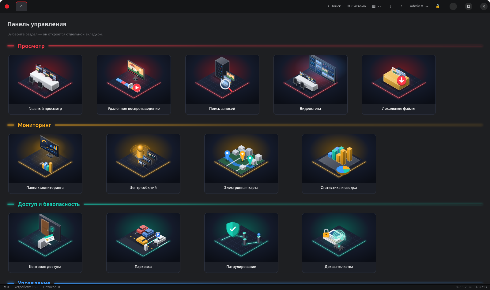

Главное окно открывается с размером по доступному монитору и остаётся изменяемым. Длинные панели действий переносятся на несколько строк, страницы прокручиваются, когда не хватает места. Используется системный масштаб рабочего стола.

**Панель управления** — стартовая страница с разделами, сгруппированными по назначению: «Просмотр», «Мониторинг», «Доступ и безопасность», «Управление». Раздел открывается отдельной вкладкой.

Остальные части окна:

- **Заголовок** — вкладки видов (каждая вкладка — отдельная видеосетка; «＋» создаёт «Новый вид N», изменённый вид помечается «*»; правая кнопка — «Сохранить вид», «Сохранить как…», «Открыть в новом окне», «Закрыть»). Справа «Поиск», «Система», меню модулей ▦, локальные файлы ⤓, справка, меню пользователя и блокировка 🔒.
- **Левая панель** — поиск, дерево ресурсов (области → устройства → камеры и двери, состояние «в сети / не в сети», правая кнопка — действия), секции «Карта», «Статистика», «Веб-страница», «Локальные файлы», «Вид» (группы видов), «PTZ» и настраиваемые «Ярлыки» (✎).
- **Нижняя полоса** — «Живой просмотр | Воспроизведение», шкала времени и инструменты просмотра (см. [Архив и воспроизведение](#архив-и-воспроизведение)).
- **Правая панель** — «Тревога» и «Событие», колокольчик — история уведомлений (см. [Тревоги](#тревоги-события-и-охрана)).
- **Адаптивность** — на узком окне панели сворачиваются автоматически (ручки ‹ › по краям), подписи верхних кнопок сокращаются, фильтры шкалы скрываются. Главное меню разделов скрывается кнопкой ☰, панель камер и PTZ — кнопкой у сетки (при скрытой панели она подписана «Каналы»). Скрытые панели полностью освобождают ширину для видео.
- Модули (поиск записей, центр событий, карта, контроль доступа, статистика, локальные файлы) открываются окном поверх видеосетки, Esc закрывает.

**Меню по ролям.** Модули в меню ▦, кнопка «Поиск», разделы левой панели (карта, статистика, локальные файлы, PTZ), правая панель тревог, режим воспроизведения и кнопка PTZ на окне видео показываются только при наличии прав у роли пользователя. Открыть модуль без прав нельзя.

---

## Живой просмотр

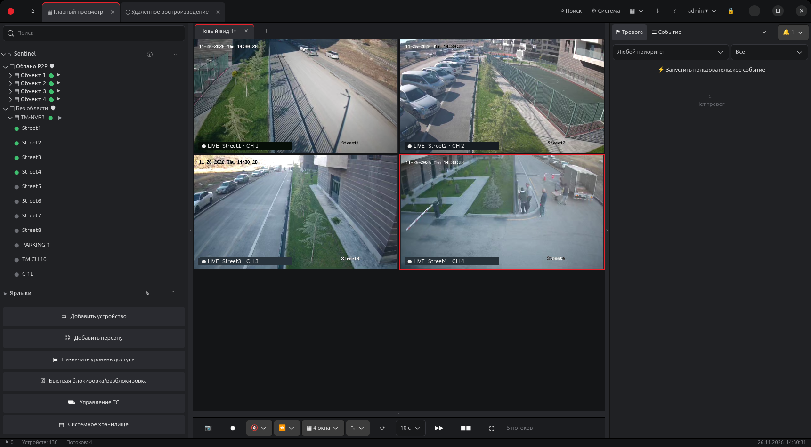

**Сетки.** Предустановленные деления (включая 6, 7, 8, 13 и широкие) и пользовательские сетки с заданным числом строк и колонок. Кнопка «Все камеры» последовательно открывает доступные каналы, до 64 в одной сетке. Каждая плитка подстраивается под соотношение сторон потока; строки не растягиваются по высоте и прокручиваются, только если плитки не помещаются.

**Назначение камер.** Камеру перетаскивают из дерева ресурсов в нужную ячейку (занятая ячейка заменится). Перетаскивание камеры между ячейками меняет их местами. Правый клик на камере в дереве открывает быстрые действия для живого просмотра, выбранной ячейки и архива; правый клик на ячейке — действия потока.

**Потоки.** В сетках от 9 окон ISAPI-камеры автоматически используют дополнительный поток и сниженную частоту обновления миниатюр. Двойной клик по плитке разворачивает её и переключает на основной поток, повторный двойной клик возвращает сетку.

**Нижняя панель.** Снимок, ручная запись, звук, мгновенный повтор с выбором интервала, раскладка, автопереключение по камерам с интервалом, полноэкранный режим (F11, выход — Esc).

### Панель инструментов окна видео

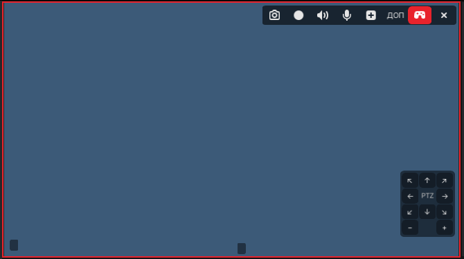

При наведении на окно с камерой справа сверху появляются кнопки: снимок, клип (запись живого потока), звук, двусторонняя связь, цифровой зум ×2 и сброс, основной / дополнительный поток, PTZ и закрыть.

- **PTZ.** В углу окна появляется джойстик. Щелчок по картинке центрирует камеру, рамка слева направо приближает выбранную область, справа налево — отдаляет (учитывается цифровой зум). Стрелки, цифровой блок, +/−, PageUp/PageDown управляют выбранной камерой.
- **Двусторонняя связь** передаёт микрофон компьютера на динамик устройства (G.711 µ-law/A-law по настройке устройства). Звук с устройства включается кнопкой «Звук».

### Виды и дополнительные окна

Окна просмотра, назначенные камеры и их позиции сохраняются автоматически и восстанавливаются при следующем запуске. Кнопка «Удалить сохранение» закрывает окно и убирает его из восстановления.

Дополнительные окна просмотра создаются отдельно: задаются название, число камер (1–64), начальная камера и экран назначения. В них по умолчанию используется дополнительный поток, камеры запускаются постепенно, полноэкранный режим запрашивается на выбранном мониторе (если оконный менеджер проигнорирует назначение, окно можно перетащить вручную).

**Приватные и публичные виды.** При подключении к Sentinel Server в окне «Сохранить вид» появляется выбор «Где хранить»:

- этот компьютер;
- «Сервер · приватный» — виден только вам с любого клиента;
- «Сервер · публичный» — виден всем клиентам; создавать и менять такие виды может пользователь с правом «Системная конфигурация».

Виды сервера показываются в разделе «Вид» группами «Сервер · публичные» и «Сервер · мои» и обновляются у всех клиентов сразу. Камеры в них хранятся по адресу устройства и каналу, поэтому вид открывается в любом клиенте, где эти камеры есть в каталоге.

---

## Архив и воспроизведение

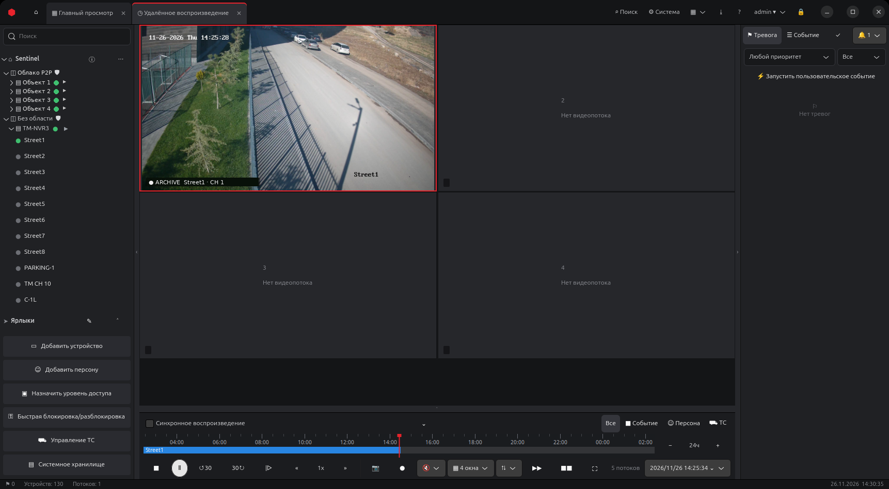

**Режим «Воспроизведение»** в нижней полосе показывает шкалу времени, на которой видны записи регистратора, резервные записи компьютера и события. Доступны:

- синхронное воспроизведение нескольких окон;
- фильтры «Все / Событие / Персона / ТС»;
- масштаб от 24 часов до 10 минут (колесо мыши);
- пауза, переход на ±30 с, покадровый режим, скорость 0.25×–8×, переход к дате.

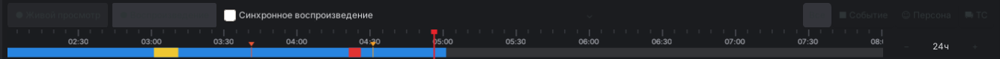

Цвета на шкале: синий — непрерывная запись, жёлтый — движение, красный — тревога, фиолетовый — интеллектуальное событие, зелёная полоска — резервная запись компьютера. События отмечены флажками: щелчок по флажку перематывает на 5 секунд до события и открывает его карточку (время, камера, снимок, данные).

### Поиск записей

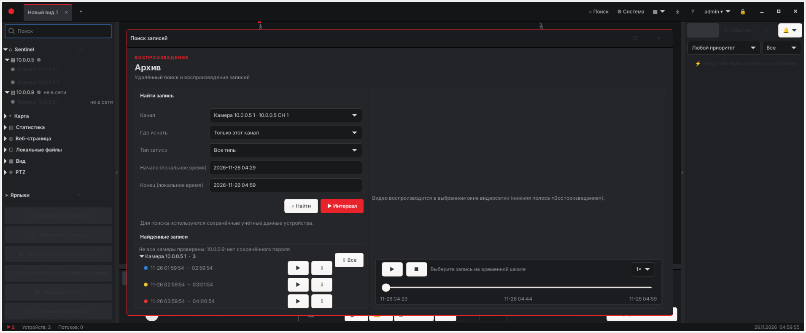

Поиск по каналу, по всем каналам регистратора или по всем камерам области, с фильтром по типу записи (непрерывная, движение, тревога, интеллектуальное событие) и локальным интервалом времени. Результаты сгруппированы по камерам, тип отмечен цветом. Щелчок по отрезку запускает воспроизведение с этой позиции в видеосетке. Кнопка «Интервал» воспроизводит интервал без поиска.

Учётные данные берутся из каталога устройств и при необходимости запрашиваются один раз.

### Экспорт

Экспорт записи или всех записей камеры создаёт пакет в `~/Videos/Sentinel/Evidence`:

- видео MP4 без перекодирования;
- `index.html` — плеер, который открывается в любом браузере без установки программ;
- `manifest.json` — камеры, время, кто экспортировал;
- `SHA256SUMS` для проверки целостности (`sha256sum -c SHA256SUMS`);
- ZIP-архив всего пакета.

Экспорт записывается в журнал операций, после него Sentinel предлагает положить пакет в [дело](#доказательства).

---

## Панель мониторинга

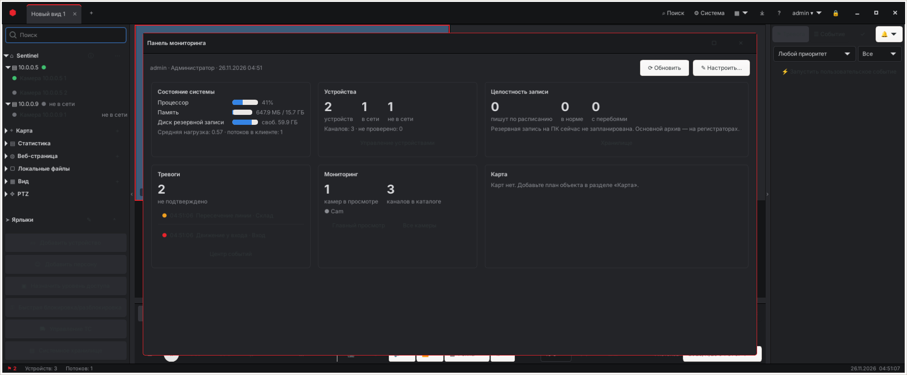

Открывается значком ⬢ слева вверху или через «Модули ▦ › Панель мониторинга». Виджеты:

- «Мониторинг» — камеры в просмотре и каналы в каталоге;
- «Тревоги» — неподтверждённые тревоги;
- «Состояние системы» — процессор, память, диск резервной записи;
- «Устройства» — в сети и не в сети;
- «Целостность записи» — камеры, которые по расписанию должны писать на компьютер, но не пишут;
- «Карта» и «События сегодня».

Набор виджетов настраивается для каждого пользователя («Настроить…»), по умолчанию зависит от роли. Там же включается открытие панели при запуске.

---

## Тревоги, события и охрана

**Правая панель «Тревога»** — приоритеты, фильтры, «Подтвердить все», «Запустить пользовательское событие». Вкладка «Событие» показывает персоны, ТС и прочие события.

Щелчок по тревоге открывает окно «Подробности тревоги»: изображение, видео ±30 секунд вокруг события, журнал операций, приоритет, категория, примечание, кнопки «Подтвердить», «Тревожный выход…», «На карте», «В дело…».

**Правила тревог** настраиваются в «Система › События и тревоги»: тип события, источники, списки ТС для распознавания номеров («из списка / не из списка»), расписание, получатели и действия — всплывающее окно, снимок, запись, тревожные выходы с автозакрытием (для шлагбаума), PTZ-пресет, email, вывод на видеостену.

**Охрана.** Систему, область (группу устройств) или отдельные каналы можно поставить на охрану и снять с неё:

- правым щелчком по области или устройству в дереве ресурсов;
- через точку на карте;
- кнопками «Поставить всё на охрану / Снять всё с охраны» в центре событий.

Действует самое узкое правило (канал → область → система), по умолчанию всё под охраной. Снятые с охраны каналы продолжают писать события в журнал, но тревоги и связанные действия для них не срабатывают (кроме пользовательского события). В дереве ресурсов у области показывается 🛡 / ○ / ◐, у устройства — «снято».

---

## Электронная карта

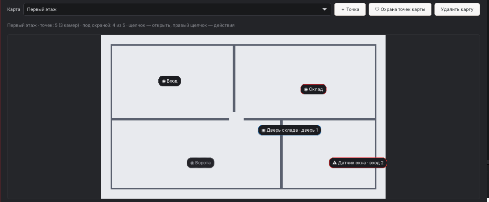

Карта бывает двух типов:

- **«Своё изображение»** — план этажа, схема или снимок;
- **«Онлайн-карта»** — подложка из тайлов (Web Mercator), точки стоят по широте и долготе.

На карту ставят точки камер, дверей и тревожных входов. При событии от устройства его точки мигают (при тревоге — минуту или до щелчка или подтверждения). Щелчок по камере открывает видео (и карточку новой тревоги, если она есть), по двери — дверь в окне, по входу — карточку тревоги. Правый щелчок по точке — видео, записи, охрана, «Переместить точку», удаление. Правый щелчок по пустому месту — «Добавить точку здесь». Снятые с охраны точки показаны приглушённо.

**Онлайн-карта** двигается мышью и стрелками, масштаб — колесом, двойным щелчком и кнопками «−/+». «⤢ Все точки» вписывает все точки в окно, строка поиска находит адрес или координаты (`55.7558, 37.6173`). В меню пустого места добавлены «Центрировать здесь» и «Копировать координаты». Центр и масштаб запоминаются.

Настройки — «Конфигурация системы › Онлайн-карты»: подложка по умолчанию (схема, рельеф, спутник, светлая, тёмная), свои источники тайлов (сервер в закрытой сети, подложка по ключу или папка `/путь/{z}/{x}/{y}.png`), режим «без интернета» (только сохранённые тайлы), срок обновления и предел кэша (`~/.cache/sentinel/tiles`), сервис поиска адреса, центр и масштаб новых карт.

---

## Контроль доступа

Модуль «Контроль доступа». Вверху индикатор «Не применено на контроллерах» (сколько персон и правил изменено, но ещё не записано) и кнопка «Применить изменения». Изменение уровня доступа или отдела сразу помечает затронутых персон как неприменённых.

### Мониторинг

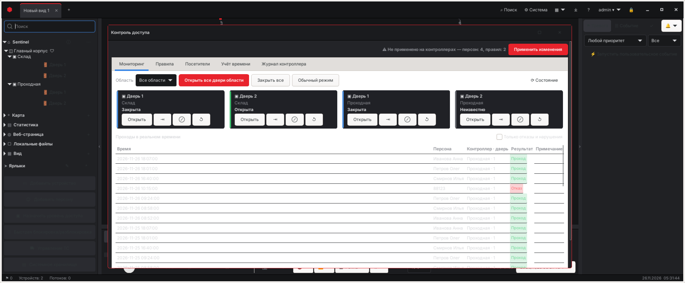

Карточки дверей с состоянием (открыта / закрыта / неизвестно) и кнопками «Открыть», «Всегда открыта», «Всегда закрыта», «Обычный режим». Команда для всех дверей выбранной области — с подтверждением. Лента проходов в реальном времени: кто, где, проход или отказ, нарушения анти-passback; фильтр «Только отказы и нарушения».

### Правила

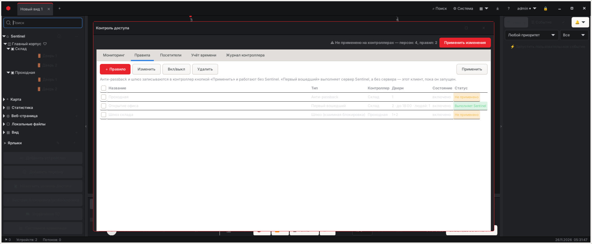

- **Анти-passback** — вход/выход для каждой двери или маршрут из нескольких дверей.
- **Шлюз** — в группе дверей открыта только одна.
- **«Первый вошедший»** — дверь остаётся открытой до заданного времени, когда пришёл первый человек из списка.

Анти-passback и шлюз записываются в контроллер (`AntiSneakCfg`, `CardReaderAntiSneakCfg`, `MultiDoorInterLockCfg`) и работают без Sentinel. Конфигурация отправляется целиком, поэтому выключенное или удалённое правило снимается с устройства. «Первый вошедший» выполняет Sentinel Server, а без сервера — клиент.

### Посетители

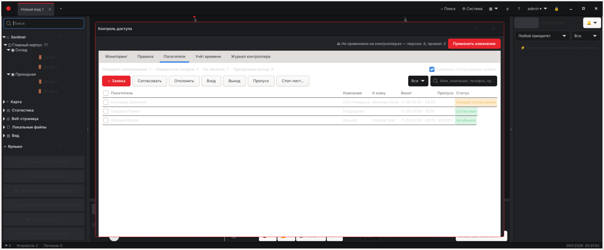

- Заявка: имя, компания, документ, к кому, цель, время, уровень доступа; согласование (можно выключить).
- Регистрация входа с выдачей пропуска: временная персона «V‹номер›» с картой и уровнем доступа до конца визита записывается на контроллеры.
- Печать пропуска (HTML, A6).
- Регистрация выхода — пропуск стирается с контроллеров.
- Счётчики «ожидают / ожидаются / на объекте / просрочили выход».
- Стоп-лист: совпадение по документу, телефону или имени останавливает вход, решение оператора пишется в журнал.

### Учёт рабочего времени

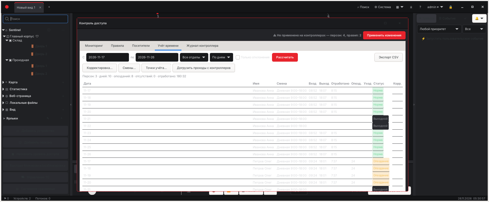

- Смены: время, перерыв, допуски опоздания и раннего ухода, рабочие дни, ночные смены; смена по умолчанию и по отделам.
- Точки учёта: двери «вход», «выход» или «оба» (без выбора учитываются все двери).
- Отчёт по дням и итоги за период: приход, уход, отработано, опоздания, ранние уходы, переработка, отсутствия, праздники из «Конфигурации».
- Корректировки с причиной (забыл отметиться, отпуск, больничный, командировка, отгул) — двойной щелчок по строке.
- Экспорт CSV, догрузка пропущенных проходов из памяти контроллеров.

### Журнал контроллера

Поиск событий прямо на контроллере.

---

## Парковка

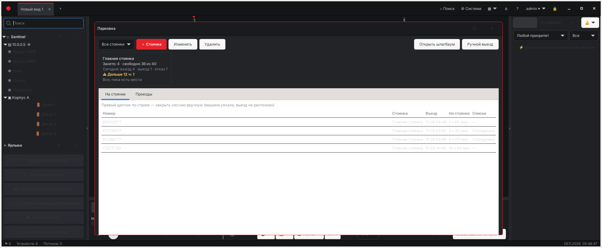

Стоянка описывается так: камеры распознавания номеров на въезде и выезде, число мест, режим въезда («только разрешённые списки» или «все, пока есть места»), чёрные списки и шлагбаумы (тревожный выход с автозакрытием, отдельный для выезда при необходимости).

- Номер из чёрного списка не пропускается, номера из разрешённых списков проезжают и на полную стоянку.
- Выезд закрывает сессию даже при одной ошибке распознавания.
- Отказ создаёт событие «Парковка: отказ во въезде», на него можно настроить тревогу.
- Карточки занятости, предупреждение о машинах, стоящих дольше заданного времени.
- Список машин на стоянке (правый щелчок — закрыть сессию вручную), история проездов с поиском по номеру и экспортом CSV.
- Ручное открытие шлагбаума с записью оператора.

При подключении к Sentinel Server решения принимает сервер.

---

## Патрулирование

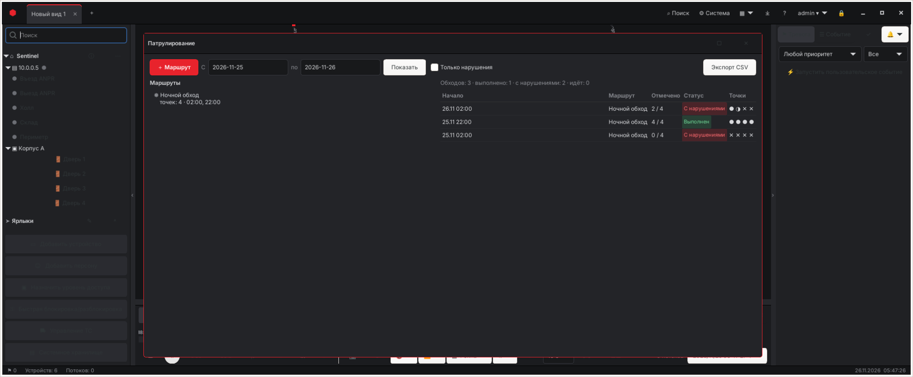

Маршрут — контрольные точки (считыватели дверей) по порядку с временем от начала обхода, охранники, время начала обходов, дни недели и допуск. Отметки берутся из событий контроля доступа.

Для каждого обхода точки отмечаются «вовремя / рано / поздно / пропущена», обход — «выполнен / с нарушениями / идёт». Подробности — по двойному щелчку, экспорт CSV. Пропущенная точка создаёт событие «Патруль: пропущена точка» (проверяет сервер, без сервера — клиент).

---

## Доказательства

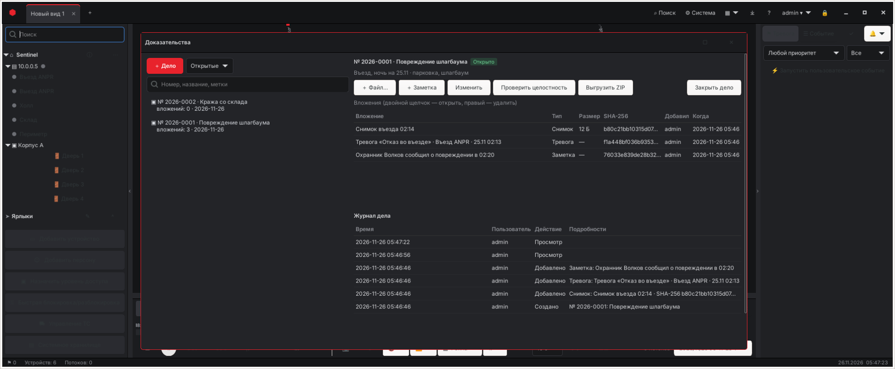

Дела с номером (ГГГГ-NNNN), описанием и метками. Вложения:

- файлы и пакеты экспорта — копируются в хранилище дела, для каждого считается SHA-256;
- тревоги — кнопка «В дело…» в карточке тревоги, вместе со снимком;
- заметки.

Журнал дела фиксирует создание, просмотр, добавление, удаление (только с указанием причины), проверку целостности, выгрузку и закрытие. Закрытое дело изменить нельзя. «Выгрузить ZIP» сохраняет файлы, `manifest.json`, `custody_log.json` и `SHA256SUMS`.

---

## Видеостена

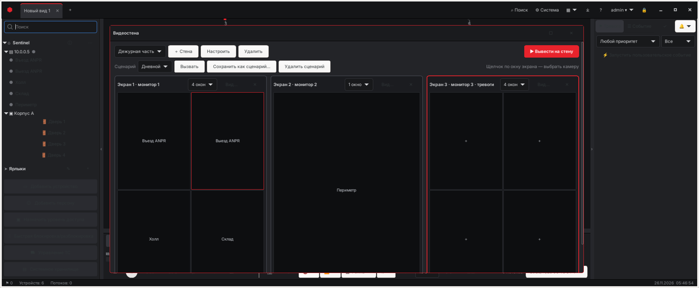

- Стена из мониторов этого компьютера (до 4×6), у каждого экрана своя раскладка (1/4/6/9/16) и свои камеры. Камеру ставят щелчком по окну, сохранённый вид выводится на экран целиком.
- **Сценарии** сохраняют и вызывают содержимое всей стены.
- **«Вывести на стену»** открывает по полноэкранному окну на каждый монитор.
- **Экран тревог**: камера тревоги выводится в свободное окно (или по кругу), через заданное время окно возвращается к прежней камере. Работает для правил с действием «На видеостену» или для всех тревог, включая тревоги с сервера.

Аппаратные декодеры видеостен не поддерживаются.

---

## Окно «Система»

- **Управление устройствами** — вкладки «Видео», «Контроль доступа», «Области»; состояние, серийный номер, версия, «Обновить всё», синхронизация времени, экспорт CSV; добавление через автопоиск, пакетный импорт или вручную; карточка устройства с параметрами, ресурсами и перезагрузкой.
- **Персоны и отделы** — карты, PIN, срок действия, импорт и экспорт CSV.
- **Транспорт** — списки ТС, номера, привязка к персоне, перенос между списками.
- **Уровни доступа** — двери и расписание 7×24, назначение персонам и отделам, «Применить всё».
- **Видеодомофон**.
- **События и тревоги** — подписка на события всех устройств и правила тревог (см. [Тревоги](#тревоги-события-и-охрана)).
- **Учётные записи** — пользователи, роли с правами, срок действия пароля, автоблокировка, блокировка после неудачных входов, вход при запуске.
- **Конфигурация** — SMTP, системное хранилище, сроки хранения, праздники, синхронизация времени, протоколы, модули, видео и декодирование, онлайн-карты, кластер серверов.

---

## Декодирование на видеокарте

«Система › Конфигурация системы › Видео и декодирование»:

- **Режим:** «Автоматически» (выбор GStreamer), «Видеокарта» или «Процессор».
- **Интерфейс видеокарты:** VA-API для Intel и AMD, NVIDIA NVDEC или V4L2; можно оставить «Любая доступная».
- На странице видно, какие аппаратные декодеры найдены и какой декодер работает в каждом открытом окне (он же показан в «Информации о потоке»).
- После сохранения открытые окна переоткрываются с новым декодером.

Что установить:

- **Intel и AMD:** драйвер VA-API (`intel-media-va-driver` или `mesa-va-drivers`) и `gstreamer1.0-plugins-bad`. Проверка драйвера — `vainfo`.
- **NVIDIA:** проприетарный драйвер и `gstreamer1.0-plugins-bad` (nvcodec).

Если появились артефакты или чёрные окна, верните «Процессор».

---

## Резервная запись и резервное копирование

**Резервная запись на компьютер** («Настройка записи» у камеры): FFmpeg пишет 10-минутные сегменты без перекодирования по недельному расписанию в `~/Videos/Sentinel/storage`. Старые файлы удаляются по сроку хранения и при нехватке места. Основной архив остаётся на регистраторе.

**Резервное копирование** (меню пользователя) создаёт согласованную копию базы SQLite. Пароли устройств в неё не входят — они хранятся в Secret Service.

Снимки и записи сохраняются в `~/Pictures/Sentinel` и `~/Videos/Sentinel`.

---

## Облако P2P

«Система › Управление устройствами › Добавить устройство › **Облако P2P**» (или меню пользователя › «Облачный сервис P2P…»):

1. Введите логин (email или телефон) и пароль облачного аккаунта и выберите сервер: «Международный» (регион определяется автоматически) или «Россия» (отдельная платформа). Можно указать свой адрес.
2. Появится список устройств аккаунта: имя, серийный номер, модель, «в сети / не в сети», локальный IP, внешний адрес, число каналов, отметка «В каталоге».
3. Отметьте устройства, укажите **логин и пароль самого устройства** и способ доступа (локальный IP, внешний адрес с пробросом портов или авто), нажмите «Добавить выбранные» или «Добавить все в сети».

Каналы и их имена берутся из облака, скрытые в облаке каналы не импортируются. Устройства попадают в область «Облако P2P» дерева ресурсов, их состояние обновляется из облака.

**Как это устроено.** Открытого API у облака нет, Sentinel повторяет запросы мобильного приложения. Пароль аккаунта уходит в облако только MD5-хешем; сессия (и пароль, если отмечено «Запомнить пароль») хранится в Secret Service и продлевается автоматически. Архив, запись и настройка идут напрямую по ISAPI/RTSP, поэтому для них устройство должно быть доступно из сети клиента (локальная сеть, VPN или проброс портов). Если облако запросит код с картинки или подтверждение нового устройства, один раз войдите в официальное мобильное приложение и повторите. Протокол облака может меняться без предупреждения.

### Живое видео через облако

Если регистратор недоступен напрямую (облако сообщает локальный адрес чужой сети, порты не проброшены) или для него не введён пароль устройства, живое видео идёт через облачный ретранслятор — как в мобильном приложении. Пароль регистратора не нужен, используется сессия аккаунта. После первой неудачи прямого подключения Sentinel запоминает, что этот регистратор смотрится через облако; изменение адреса или пароля в «Система › Устройства» снова включает прямой путь.

Протокол реализован в открытых библиотеках [pyezvizapi](https://pypi.org/project/pyezvizapi/) и [hikcloudstream](https://pypi.org/project/hikcloudstream/) (Apache-2.0), им нужен Python 3.12+ и FFmpeg. Поток H.264/H.265 разбирается из RTP самим Sentinel и передаётся в GStreamer как MPEG-TS.

- **Flatpak и AppImage** уже содержат эти библиотеки (в AppImage — вместе с Python 3.12).
- **.deb и исходники**: при первом облачном просмотре Sentinel ставит библиотеки в `~/.local/share/sentinel/cloud-runtime` (нужны интернет, Python 3.12+ и `python3-venv`; на Ubuntu 22.04 поставьте `python3.12` и `python3.12-venv`). Вручную: `python3 sentinel_cloudstream.py --install`. Готовый Python с библиотеками можно указать в `SENTINEL_CLOUD_PYTHON`.

Если на регистраторе включено шифрование видео, Sentinel спросит **код проверки устройства** (6 заглавных букв на наклейке или в настройках шифрования) и сохранит его в Secret Service.

Ограничения: архив и запись на компьютер облачного потока пока не поддерживаются, визуальный PTZ и разговор тоже. У облака два потока (основной и дополнительный), третий открывается как дополнительный. Каждое окно — отдельное соединение с облаком.

---

## Sentinel Server

`sentinel-server` — служба без графического интерфейса:

- общий каталог устройств, пользователи и роли (те же права, что в клиенте);
- круглосуточная подписка на события всех устройств;
- правила тревог с действиями (запись тревоги, снимок, запись FFmpeg, тревожный выход с автозакрытием, PTZ-пресет, email);
- резервная запись по расписанию, проверка состояния, синхронизация времени, сроки хранения;
- синхронизация облачных аккаунтов P2P.

Нужен только Python 3.10+ со стандартной библиотекой, GTK не требуется.

### Установка пакетом

Пакет `sentinel-pro-server_<версия>_all.deb` (до 0.6.4.3 назывался `sentinel-server` и заменяется автоматически) ставит службу systemd от отдельного пользователя `sentinel`. База — в `/var/lib/sentinel-server`, настройки — в `/etc/default/sentinel-server`.

```sh
sudo apt install ./sentinel-pro-server_<версия>_all.deb
```

При первой установке служба включается и запускается сама (слушает только `127.0.0.1`). Дальше всё делается с рабочего стола:

- **«Sentinel Server»** в меню приложений запускает значок в трее (он же запускается при входе в систему). Цвет значка: зелёный — работает, жёлтый — запускается или не создан администратор, красный — ошибка (с уведомлением), серый — остановлен. Двойной щелчок открывает настройки, правая кнопка — «Перезапустить», «Остановить», «Запустить / возобновить», «Выход (остановить сервер)». «Выход» останавливает службу со всеми процессами (включая запись FFmpeg), закрывает окно настроек и убирает значок.
- **«Настройки Sentinel Server»**: состояние и адрес для клиента, запуск, остановка и перезапуск, автозапуск при включении компьютера, журнал службы; логин и пароль администратора (нет такого пользователя — создаётся с ролью «Администратор», есть — пароль заменяется и снимается блокировка); доступ (только этот компьютер / вся сеть / свой адрес), порт, сертификат TLS, «Создать самоподписанный сертификат» (`/etc/sentinel-server/cert.pem` с адресами компьютера в SAN), разрешение HTTP без TLS.
- **Первый запуск**: если сервер работает, а администратора нет, значок сам открывает окно «Задайте логин и пароль администратора».

Запуск и остановка службы идут через `systemctl`: правило polkit из пакета разрешает их без пароля администраторам компьютера (группа `sudo`). Изменение настроек, паролей и сертификата идёт через `pkexec` и спрашивает пароль администратора компьютера (один раз на несколько минут).

### Консоль

```sh
sudo sentinel-server reset-password                    # логин admin: создать или сменить пароль, снять блокировку
sudo sentinel-server reset-password --username valerii # другой администратор
sudo sentinel-server list-users
sudo systemctl enable --now sentinel-server
```

Из исходников:

```sh
python3 sentinel_server.py --data-dir ~/sentinel-server create-admin
python3 sentinel_server.py --data-dir ~/sentinel-server run --port 8765

# по сети — только с TLS (без него сервер не запустится, если не указать --allow-plain-http)
python3 sentinel_server.py run --host 0.0.0.0 --tls-cert cert.pem --tls-key key.pem

# облачный аккаунт P2P из консоли
python3 sentinel_server.py hikconnect-login --account user@example.com --region ru --remember
python3 sentinel_server.py hikconnect-devices
```

У службы нет пользовательского D-Bus, поэтому пароли устройств и облачные сессии она хранит в `secrets.json` с правами 0600 в своём каталоге (`SENTINEL_CREDENTIAL_STORE=file`; файл не шифруется, защищён правами учётной записи службы). При запуске от обычного пользователя без этой переменной используется Secret Service.

### Подключение клиента

Меню пользователя › «Сервер Sentinel PRO…»: адрес (`https://сервер:8765`), пользователь и пароль сервера, проверка сертификата или свой файл CA, приём тревог сервера, автоподключение при запуске, резервный адрес. «Загрузить устройства сервера в клиент» копирует каталог сервера (с паролями, если у пользователя есть право «Живой просмотр»). Пока клиент подключён, облачные аккаунты P2P, синхронизация и импорт работают через сервер.

### REST API

`/api/v1`, JSON, заголовок `Authorization: Bearer <токен>`. Токен живёт 12 часов, продлевается при использовании и сбрасывается при перезапуске сервера.

| Метод и путь | Право | Назначение |
|---|---|---|
| `GET /health` | — | версия, нужна ли активация, активность и роль узла |
| `POST /auth/login`, `POST /auth/logout`, `GET /auth/me`, `POST /auth/password` | — | вход по пользователю Sentinel (блокировка после неудачных попыток — по политике безопасности) |
| `GET /system`, `GET /log` | —, system | сводка сервера, журнал операций |
| `GET/POST /devices`, `PATCH/DELETE /devices/{id}`, `POST /devices/check` | live / devices | каталог (без паролей), добавление с автоопределением каналов |
| `GET /devices/{id}/stream?stream=main\|sub` | live | RTSP-адрес с учётными данными (действие пишется в журнал) |
| `POST /devices/{id}/alarm-output` | alarm_ack | тревожный выход |
| `GET /events`, `POST /events` | live / alarms | журнал событий, пользовательское событие |
| `GET /alarms`, `POST /alarms/ack` | alarm_ack | тревоги и подтверждение |
| `GET /stream` | — | Server-Sent Events: `event`, `alarm`, `alarm_ack`, `device_status`, `cloud_sync`, `notice` (поддерживает `Last-Event-ID`) |
| `GET/POST /users`, `DELETE /users/{id}` | users | пользователи и роли |
| `GET/POST /views`, `PUT/DELETE /views/{id}` | live (публичные виды — system) | приватные и публичные виды |
| `GET /arming`, `POST /arming` | live / alarm_ack | постановка на охрану и снятие |
| `GET /hikconnect/regions`, `GET/POST /hikconnect/accounts`, `PATCH/DELETE /hikconnect/accounts/{id}`, `POST /hikconnect/accounts/{id}/sync`, `GET /hikconnect/devices`, `POST /hikconnect/import` | devices (список — live) | облачные аккаунты P2P, устройства, импорт |

Клиентская библиотека для своих скриптов — `sentinel_remote.ServerClient`.

---

## Кластер: горячий резерв

Два сервера — основной и резервный — работают в паре. Активен всегда один: он принимает клиентов, получает события устройств, пишет архив и выполняет правила. Резервный узел раз в несколько секунд опрашивает основной (heartbeat) и забирает копию базы, когда она меняется. Если основной не отвечает дольше заданного времени (по умолчанию 30 с), резервный берёт роль и запускает все службы.

### Настройка из интерфейса

Клиент › «Система» › «Конфигурация системы» › «Кластер серверов» (или кнопка «Кластер серверов…» в окне «Сервер Sentinel PRO…»). Нужны подключение к серверу и право «Система».

- Страница показывает состояние пары и журнал кластера.
- Задаются роль сервера, второй узел, общий ключ, контрольный узел и интервалы.
- Кнопки «Взять роль на этот узел» и «Вернуть роль основному».
- «Мастер пары серверов…» настраивает оба сервера за один шаг: создаёт ключ, назначает роли и сохраняет резервный адрес в клиенте.

Изменения применяются сразу, без перезапуска службы.

### Из консоли

```sh
# на основном узле: выдаёт общий ключ
sudo sentinel-server cluster-init --role primary --peer https://10.0.0.2:8765 --ca-file /etc/sentinel/peer.pem
# на резервном: тот же ключ, адрес основного и (рекомендуется) контрольный узел
sudo sentinel-server cluster-init --role standby --peer https://10.0.0.1:8765 --key <ключ> --witness 10.0.0.254:80
sudo systemctl restart sentinel-server
sudo sentinel-server cluster-status
```

### Как работает

- **Защита от «двух активных».** С `--witness` (шлюз или другой всегда доступный узел, `host:port`) резервный берёт роль, только если сам видит контрольный узел: потеря собственной сети не вызывает переключения. Если основной вернулся, а резервный уже активен, основной остаётся в ожидании.
- **Возврат роли** — вручную, когда основной снова в порядке: `POST /api/v1/cluster/failback` на основном узле. Он забирает свежую базу у резервного, переводит его в ожидание и становится активным. `POST /cluster/promote` на резервном переключает вручную (например, на время обслуживания основного).
- **Безопасность.** Узлы обмениваются по HTTPS, каждый запрос подписан HMAC-SHA256 общим ключом (подпись действует 60 с). Снимок базы передаётся с контрольной суммой SHA-256 и проверяется `PRAGMA integrity_check` перед заменой. Настройки — в `cluster.json` с правами 0600.
- **Пароли устройств** реплицируются вместе с базой, только если служба хранит их в файле (`SENTINEL_CREDENTIAL_STORE=file`, по умолчанию для пакета). С Secret Service их нужно один раз ввести на резервном узле.
- **Клиенты.** В «Сервер Sentinel PRO…» укажите резервный адрес. При потере связи клиент сам находит активный узел, входит снова (пароль хранится только в памяти на время сеанса) и сообщает «Переключено на сервер …». В строке состояния видны роль узла и состояние пары.
- **Ограничения.** Записи архива на дисках узлов не копируются: каждый узел пишет свой архив, пока он активен. При переключении теряются изменения после последней синхронизации (по умолчанию не больше минуты).

| Метод и путь | Право | Назначение |
|---|---|---|
| `GET /cluster/status` | system | роль, состояние второго узла, время синхронизации, журнал кластера |
| `GET /cluster/config`, `PUT /cluster/config` | system | настройки узла; изменение применяется сразу (пустой ключ — сервер создаёт новый) |
| `POST /cluster/promote`, `POST /cluster/failback` | system | ручное переключение, возврат роли основному |
| `GET /cluster/heartbeat`, `GET /cluster/snapshot`, `POST /cluster/demote` | подпись узла | служебный обмен между узлами |

Узел в ожидании отвечает клиентам `503` с полем `standby: true`.

---

## Хранение данных и безопасность

- Каталог устройств и настройки — в SQLite с ограниченными правами доступа (`~/.local/share/sentinel`).
- Пароли — в системном Secret Service (например, GNOME Keyring), в SQLite не записываются. Учётные данные повторно используются для каналов одного регистратора.
- При первом запуске старые записи паролей из SQLite переносятся в Secret Service и удаляются из базы только после успешного сохранения. Если хранилище недоступно, приложение сообщает об ошибке и сохраняет старую запись, не теряя пароль.
- Ранее созданные резервные копии базы могут содержать незашифрованные пароли.

---

## Сборка и разработка

Проверки (GTK не нужен, окно собирается на заглушке `tests/gtk_stub.py`):

```sh
python3 -m unittest discover -s tests
```

Релизные `.deb`, Flatpak и AppImage собирает GitHub Actions. Для публикации создайте и отправьте тег, совпадающий с файлом `VERSION` (например, `v0.6.4.3`): workflow проверит тесты, соберёт пакеты и прикрепит их к релизу.

Локальная сборка на Ubuntu 22.04 (нужны `dpkg-deb`, `python3-pip`, `appimage-builder==1.1.0`, `packaging==21.3`):

```sh
packaging/build-release.sh
```

Деления сетки задаются в `sentinel_layouts.py`. Локальная база устройств `data/`, сторонние SDK, плагины и демонстрационные материалы производителей намеренно не входят в репозиторий и пакеты.

---

## Ограничения

- Не реализованы: мобильное приложение, каскадный сервер, поиск по видео на естественном языке.
- Аппаратные декодеры видеостен не поддерживаются.
- Для облачных потоков пока нет архива, записи на компьютер, визуального PTZ и двусторонней связи.
- Где возможностей RTSP и ISAPI недостаточно, может потребоваться SDK производителя устройства.
